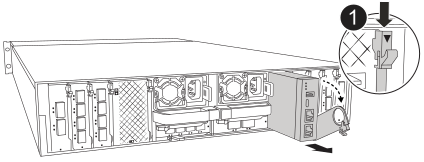
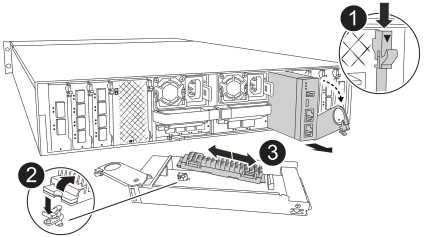

= 
:allow-uri-read: 

Le module de gestion du système contient le support de démarrage et assure les fonctions de gestion du système. Vous devez retirer le module de gestion du système défectueux, transférer le support de démarrage sur le module de remplacement et réinstaller le module de remplacement dans le boîtier.

.Étapes
. Retirez le module de gestion du système :
+

NOTE: Assurez-vous que la désactivation de la NVRAM est terminée avant de continuer. Lorsque la LED du module NV est éteinte, la NVRAM est désactivée. Si la LED clignote, attendez que le clignotement cesse. Si le clignotement persiste pendant plus de 5 minutes, contactez le support technique pour obtenir de l'aide.

+

+
[cols="1,4"]
|===

 a| 
image::../media/icon_round_1.png[Légende numéro 1]
 a| 
Loquet de came du module de gestion du système

|===
+
.. Si vous n'êtes pas déjà mis à la terre, mettez-vous à la terre correctement.
.. Débranchez les câbles d’alimentation des blocs d’alimentation.
.. Retirez tous les câbles connectés au module de gestion du système.  Étiquetez les câbles là où ils ont été connectés, afin de pouvoir les reconnecter aux ports appropriés lors de la réinstallation du module.
.. Faites pivoter le chemin de câbles vers le bas en tirant sur les boutons situés des deux côtés à l'intérieur du chemin de câbles, puis faites pivoter le bac vers le bas.
.. Appuyez sur le bouton CAM du module de gestion du système.
.. Faites tourner le levier de came vers le bas aussi loin que possible.
.. Enroulez votre doigt dans le trou du levier de came et tirez le module hors du système.
.. Placez le module de gestion du système sur un tapis antistatique pour accéder au support de démarrage.

. Déplacez le support de démarrage vers le module de gestion du système de remplacement :
+

+
[cols="1,4"]
|===

 a| 
image::../media/icon_round_1.png[Légende numéro 1]
 a| 
Loquet de came du module de gestion du système

 a| 
image::../media/icon_round_2.png[Légende numéro 2]
 a| 
Bouton de verrouillage du support de démarrage

 a| 
image::../media/icon_round_3.png[Numéro de légende 3]
 a| 
Support de démarrage

|===
+
.. Appuyez sur le bouton bleu de verrouillage du support de démarrage dans le module de gestion du système défectueux.
.. Faites pivoter le support de démarrage vers le haut et faites-le glisser hors du support.

. Installez le support de démarrage dans le module de gestion du système de remplacement :
+
.. Alignez les bords du support de coffre avec le logement de la prise, puis poussez-le doucement d'équerre dans le support.
.. Faites pivoter le support de démarrage vers le bas jusqu'à ce qu'il touche le bouton de verrouillage.
.. Appuyez sur le bouton de verrouillage bleu et faites pivoter le support de démarrage complètement vers le bas, puis relâchez le bouton de verrouillage bleu.

. Installez le module de gestion du système de remplacement dans le boîtier :
+
.. Alignez les bords du module de gestion du système de remplacement avec l'ouverture du système et poussez-le doucement dans le module de contrôleur.
.. Faites glisser doucement le module dans le logement jusqu'à ce que le loquet de came commence à s'engager avec la broche de came d'E/S, puis faites tourner le loquet de came complètement vers le haut pour verrouiller le module en place.

. Faites pivoter le ARM de gestion des câbles jusqu'à la position fermée.
. Recâblage du module de gestion du système.

