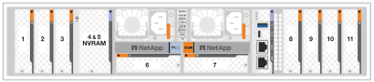

= Découvrez comment ajouter et remplacer des modules d'E/S dans un système AFX 1K
:allow-uri-read: 
:icons: font
:imagesdir: ../media/

[role="lead"]
Le système de stockage AFX 1K offre une grande flexibilité pour l’extension ou le remplacement des modules d’E/S afin d’améliorer la connectivité et les performances du réseau. L’ajout d’un module d’E/S est indispensable lors de la mise à niveau des capacités réseau. Le remplacement d’un module d’E/S est indispensable en cas de défaillance d’un module.

Vous pouvez remplacer un module d'E/S défectueux dans votre système de stockage AFX 1K par le même type de module d'E/S ou par un autre type de module d'E/S.  Vous pouvez également ajouter un module d’E/S dans un système avec des emplacements vides.

* link:io-module-add.html["Ajoutez un module d'E/S."]
+
L'ajout de modules supplémentaires peut améliorer la redondance, ce qui permet de garantir que le système reste opérationnel même en cas de défaillance d'un module.

* link:io-module-replace.html["Remplacez un module d'E/S."]
+
Le remplacement d'un module d'E/S défaillant permet de restaurer l'état de fonctionnement optimal du système.

.Numérotation des connecteurs d'E/S.
Les emplacements d'E/S du contrôleur AFX 1K sont numérotés de 1 à 11, comme indiqué dans l'illustration suivante.

