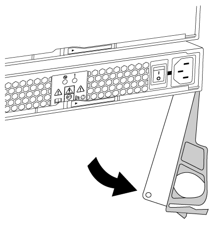

= Remplacez à chaud une alimentation dans un système FAS2600
:allow-uri-read: 
:icons: font
:imagesdir: ../media/

[role="lead"]
Remplacez à chaud l'alimentation de votre système FAS2600 en éteignant, déconnectant et retirant l'ancienne alimentation, puis en installant, connectant et allumant la nouvelle alimentation.

Si d'autres composants du système ne fonctionnent pas correctement, contactez le support technique.

* Les blocs d'alimentation sont redondants et échangeables à chaud.
* Cette procédure permet de remplacer une alimentation à la fois.
+

NOTE: Le système de refroidissement étant intégré à l'alimentation, vous devez remplacer l'alimentation dans les deux minutes suivant son retrait afin d'éviter une surchauffe due à une réduction du flux d'air. Le châssis assurant une configuration de refroidissement partagée pour les deux nœuds HA, un délai supérieur à deux minutes entraîne l'arrêt de tous les modules de contrôleur du châssis. Si les deux modules de contrôleur s'arrêtent, assurez-vous que les deux alimentations sont insérées, éteignez-les toutes les deux pendant 30 secondes, puis rallumez-les.

* Le nombre d'alimentations dans le système dépend du modèle.
* Les blocs d'alimentation sont à sélection automatique.

link:https://youtu.be/1xWZfXpXMNE["Vidéo sur le remplacement de l'alimentation électrique des systèmes AFF FAS2600"^]

.Étapes
. Identifiez le bloc d'alimentation que vous souhaitez remplacer, en fonction des messages d'erreur de la console ou des LED des alimentations.
. Si vous n'êtes pas déjà mis à la terre, mettez-vous à la terre correctement.
. Mettez le bloc d'alimentation hors tension et débranchez les câbles d'alimentation :
+
.. Eteindre l'interrupteur de l'alimentation en panne.
.. Ouvrez le dispositif de retenue du câble d'alimentation, puis débranchez le câble d'alimentation du bloc d'alimentation.
.. Débranchez le câble d'alimentation de la source d'alimentation.

. Appuyez sur le loquet de la poignée de came du bloc d'alimentation, puis ouvrez la poignée de came pour libérer complètement le bloc d'alimentation du plan central.
+

. Utilisez la poignée de came pour faire glisser le bloc d'alimentation hors du système.
+

CAUTION: Lors de la dépose d'une alimentation électrique, toujours utiliser deux mains pour soutenir son poids.

. S'assurer que l'interrupteur marche/arrêt de la nouvelle alimentation est en position arrêt.
. À l'aide des deux mains, soutenez et alignez les bords du bloc d'alimentation avec l'ouverture du châssis du système, puis poussez doucement le bloc d'alimentation dans le châssis à l'aide de la poignée de came.
+
Les blocs d'alimentation sont munis de clés et ne peuvent être installés qu'une seule fois.

+

NOTE: Ne pas exercer de force excessive lors du glissement du bloc d'alimentation dans le système. Vous pouvez endommager le connecteur.

. Fermez la poignée de came de façon à ce que le loquet s'enclenche en position verrouillée et que le bloc d'alimentation soit bien en place.
. Rebranchez le câblage du bloc d'alimentation :
+
.. Rebranchez le câble d'alimentation au bloc d'alimentation et à la source d'alimentation.
.. Fixez le câble d'alimentation à l'alimentation à l'aide de la retenue du câble d'alimentation.

+
Une fois l'alimentation rétablie, la LED d'état devrait être verte.

. Mettez la nouvelle alimentation sous tension, puis vérifiez le fonctionnement des LED d'activité des blocs d'alimentation.
+
Les LED du bloc d'alimentation sont allumées lorsque le bloc d'alimentation est en ligne.

. Retournez la pièce défectueuse à NetApp, tel que décrit dans les instructions RMA (retour de matériel) fournies avec le kit. Voir la https://mysupport.netapp.com/site/info/rma["Retour de pièces et remplacements"^] page pour plus d'informations.

