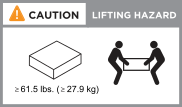
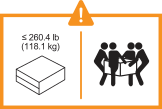

= Exigences d'installation - FAS50
:allow-uri-read: 
:icons: font
:imagesdir: ../media/

[role="lead"]
Étude des exigences relatives à votre système de stockage FAS50

[[equipment-needed-for-install]]
== Équipement nécessaire pour l'installation

Pour installer votre système de stockage, vous avez besoin de l'équipement et des outils suivants.

* Accès à un navigateur Web pour configurer votre système de stockage
* Sangle de décharge électrostatique (ESD)
* Lampe de poche
* Ordinateur portable ou console avec connexion USB/série
* Tournevis Phillips n°2

[[lifting-precautions]]
== Précautions de levage

Les systèmes de stockage et les tiroirs sont lourds. Faites preuve de prudence lorsque vous soulevez et déplacez ces éléments.

[[storage-system-weight]]
=== Poids du système de stockage

Prenez les précautions nécessaires lors du déplacement ou du levage de votre système de stockage.

Le système de stockage peut peser jusqu'à 24.4 kg (53.8 lb). Pour soulever le système de stockage, faire appel à deux personnes ou à un relevage hydraulique.

[[shelf-weight]]
=== Poids de la tablette

Prenez les précautions nécessaires lorsque vous déplacez ou soulevez votre tablette.

Une étagère DS460C peut peser jusqu'à 260,4 lb (118,1 kg). Pour soulever l'étagère, vous pourriez avoir besoin de cinq personnes ou d'un élévateur hydraulique. Gardez tous les composants dans l'étagère (à l'avant comme à l'arrière) afin d'éviter un déséquilibre du poids de l'étagère.

.Informations associées
* https://library.netapp.com/ecm/ecm_download_file/ECMP12475945["Informations de sécurité et avis réglementaires"^]

.Et la suite ?
Après avoir pris en compte la configuration requise et les considérations relatives à votre système de stockage, vous link:install-prepare.html["avant l'installation"].
