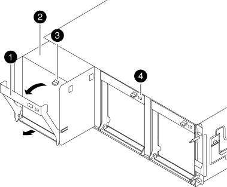

= Remplacez à chaud un ventilateur dans votre système FAS8200
:allow-uri-read: 
:icons: font
:imagesdir: ../media/

[role="lead"]
Remplacez à chaud un module de ventilateur défectueux dans votre système FAS8200 sans interrompre le service. Effectuez le remplacement en moins de deux minutes pour éviter la surchauffe du contrôleur.

NOTE: Vous devez remplacer le module de ventilation dans les deux minutes qui suivent son retrait du châssis. Le flux d'air du système est interrompu et le module de contrôleur ou les modules s'arrêtent au bout de deux minutes pour éviter toute surchauffe.

. Si vous n'êtes pas déjà mis à la terre, mettez-vous à la terre correctement.
. Retirez le cadre (si nécessaire) à deux mains, en saisissant les ouvertures de chaque côté du cadre, puis en le tirant vers vous jusqu'à ce que le cadre se dégage des goujons à rotule du châssis.
. Identifiez le module de ventilation que vous devez remplacer en vérifiant les messages d'erreur de la console et en regardant le voyant d'avertissement de chaque module de ventilation.
. Appuyez sur le loquet de déverrouillage de la poignée de came du module de ventilateur, puis tirez la poignée de came vers le bas.
+
Le module de ventilation s'éloigne légèrement du châssis.

+

+
|===

 a| 
image:../media/icon_round_1.png["Légende numéro 1"]
| Poignée de came 

 a| 

 a| 
Module de ventilateur

 a| 

 a| 
Loquet de déblocage de la poignée de came

 a| 

 a| 
Voyant d'avertissement du module de ventilateur

|===
. Tirez le module de ventilateur tout droit hors du châssis. Soutenez-le avec votre main libre pour éviter qu'il ne bascule hors du châssis.
+

CAUTION: Les modules de ventilation sont courts. Soutenez toujours la partie inférieure du module de ventilation avec votre main libre pour qu'il ne tombe pas brusquement du châssis et vous blesse.

. Mettez le module de ventilation de côté.
. Insérez le module de ventilateur de remplacement dans le châssis en l'alignant avec l'ouverture, puis en le faisant glisser dans le châssis.
. Appuyez fermement sur la poignée de came du module de ventilateur pour qu'elle soit complètement insérée dans le châssis.
+
La poignée de came se soulève légèrement lorsque le module de ventilateur est complètement en place.

. Relevez la poignée à came jusqu'à sa position fermée, jusqu'à ce que le loquet de déverrouillage de la poignée à came s'enclenche en position verrouillée.
+
La LED du ventilateur doit être verte une fois que le ventilateur est assis et a été tournée jusqu'à la vitesse de fonctionnement.

. Alignez le cadre avec les goujons à rotule, puis poussez doucement le cadre sur les goujons à rotule.
. Retournez la pièce défectueuse à NetApp, tel que décrit dans les instructions RMA (retour de matériel) fournies avec le kit. Voir la https://mysupport.netapp.com/site/info/rma["Retour de pièces et remplacements"^] page pour plus d'informations.

