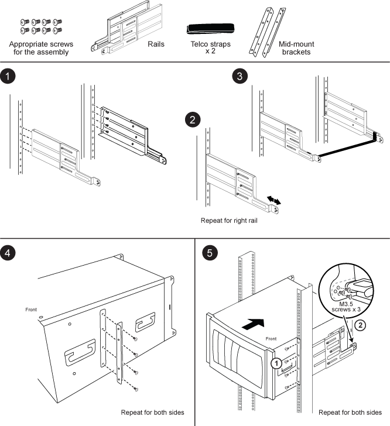
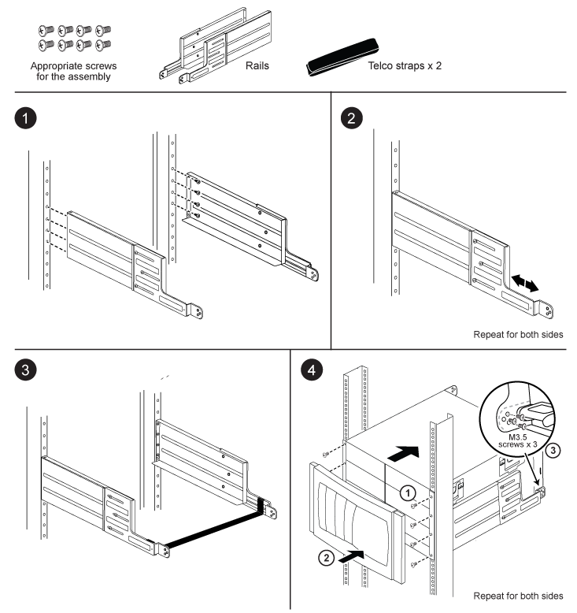

= Installez les kits de rails de support à deux montants pour un système AFF A700 ou FAS9000
:allow-uri-read: 
:icons: font
:imagesdir: ../media/

[role="lead"]
Deux kits de rails de support à deux montants peuvent être utilisés avec les systèmes FAS9000 et AFF A700. Un kit vous permet de monter votre système dans le rack à deux montants et l'autre vous permet de le monter au milieu du système dans le rack à deux montants.

[[install-the-two-post-mid-mount-rail-kit]]
== Installez le kit de rails centraux à deux montants

[[install-the-two-post-flush-mount-rail-kit]]
== Installez le kit de rails encastrables à deux montants

